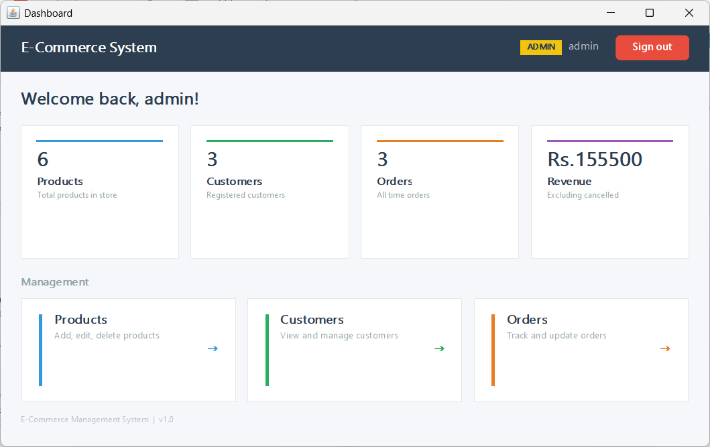
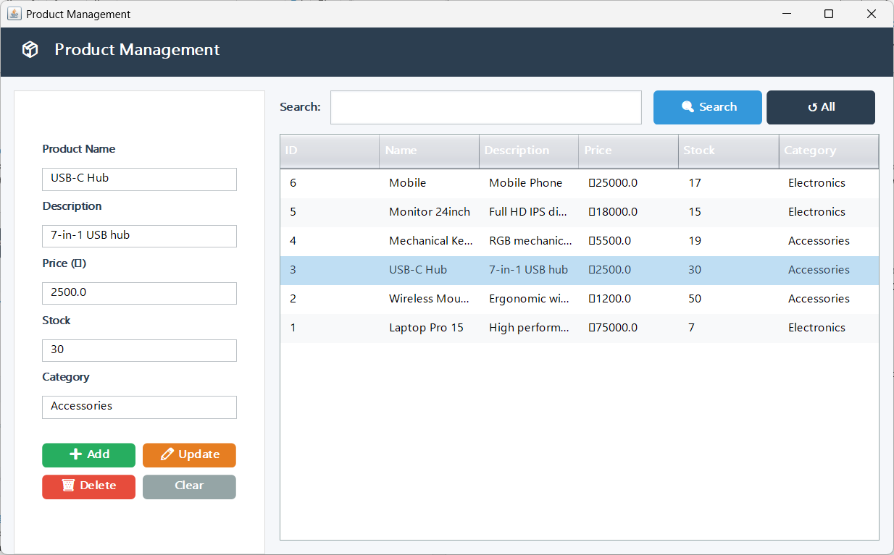
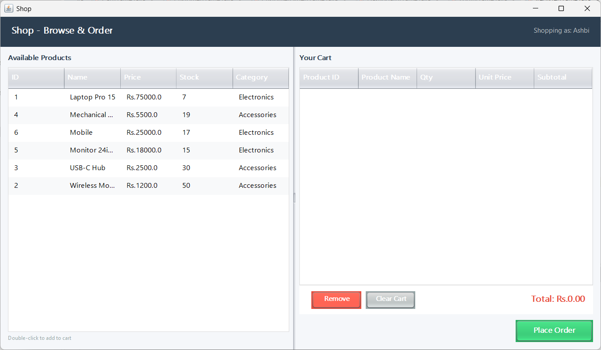
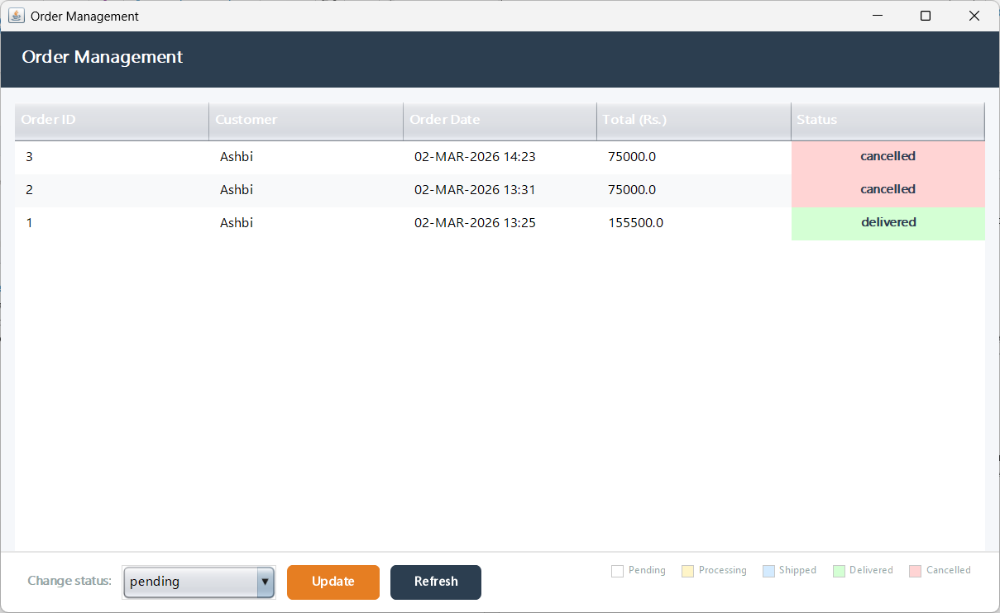
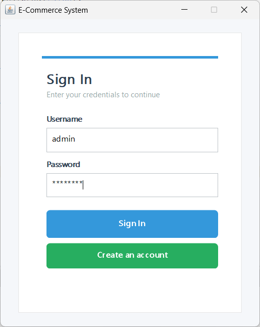
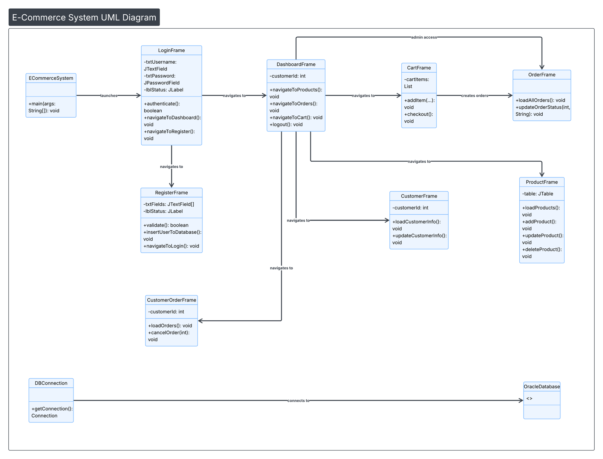

# E-Commerce Desktop Management & Shopping System


A desktop shopping and inventory management application built with **Java Swing** and backed by **Oracle Database 21c** over JDBC. Admins manage products, customers and orders; customers browse the catalogue, fill a cart and track their orders.

<p align="center">
  
</p>

## Screenshots

| Product management (admin) | Shop & cart (customer) |
|:---:|:---:|
|  |  |
| **Order management (admin)** | **Sign in** |
|  |  |

## Features

- **Role-based access** – one login screen that routes admins and customers to different dashboards.
- **Admin dashboard** – live counts of products, customers and orders, plus revenue (excluding cancelled orders).
- **Product & customer CRUD** – add, edit, delete and search, all through parameterised `PreparedStatement`s.
- **Cart & checkout** – a checkout creates the order, its line items and the stock decrement in one transaction.
- **Order lifecycle** – `pending → processing → shipped → delivered`, with customer-side cancellation of undelivered orders and colour-coded status cells.

## Architecture

<p align="center">
  
</p>

```
src/ecommercesystem/
├── ECommerceSystem.java         # Entry point (sets Nimbus look & feel)
├── DBConnection.java            # Oracle JDBC connection factory
├── LoginFrame / RegisterFrame   # Authentication
├── DashboardFrame.java          # Role-aware home screen with stats
├── ProductFrame.java            # Admin: product CRUD + search
├── CustomerFrame.java           # Admin: customer CRUD + search
├── CartFrame.java               # Customer: catalogue, cart, transactional checkout
├── OrderFrame.java              # Admin: order status management
├── CustomerOrderFrame.java      # Customer: order history + cancellation
└── UIUtils.java                 # Shared colours, fonts and button styles
database/schema.sql              # Oracle DDL + seed data
docs/                            # Full project documentation (PDF) and screenshots
```

**Data model:** `users`, `customers`, `products`, `orders`, `order_items`. See [`database/schema.sql`](database/schema.sql).

## Getting started

**Requirements:** JDK 8+, Oracle Database 21c XE (or Oracle Free), the Oracle JDBC driver (`ojdbc8.jar` / `ojdbc11.jar`), NetBeans or Apache Ant.

1. Create the schema and seed data:
   ```bash
   sqlplus <user>/<password>@localhost:1521/FREE @database/schema.sql
   ```
2. Set your connection details in `src/ecommercesystem/DBConnection.java`.
3. Add the Oracle JDBC JAR to the project libraries.
4. Run from NetBeans, or:
   ```bash
   ant run
   ```
5. Sign in as `admin` / `admin123`, or register a new customer account.

## Documentation

The full project report (requirements, design, UML, testing) is in [`docs/E-Commerce_System_Documentation.pdf`](docs/E-Commerce_System_Documentation.pdf).

## Author

**Ashbi Saju** · [GitHub](https://github.com/aashbiii) · [LinkedIn](https://linkedin.com/in/ashbi-saju)
